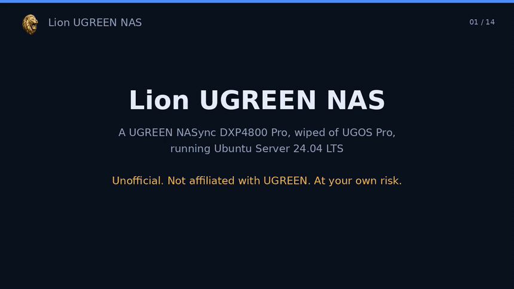

<p align="center"></p>

<h1 align="center">Lion UGREEN NAS</h1>
<p align="center"><b>A UGREEN NASync DXP4800 Pro, wiped of UGOS Pro and running Ubuntu Server 24.04 LTS</b><br>
How one four-bay NAS went from the vendor's system to plain Ubuntu Server administered over SSH: the USB installer, the
BIOS watchdog that reboots anything but UGOS, the installer answers, a two-port network layout, the 10 GbE receive
stall that cost us days and its one-line fix, an XFS data volume with a second drive inside the export, a read-only
NFS share, Wake-on-LAN, a gated power-off, and Docker Engine with its data root on the data volume. Every step we did is
dated; nothing we did not do is claimed. The configuration described was re-read from the machine on 2026-11-12; the history is from our dated notes.</p>

<p align="center"><em>Created by <a href="https://github.com/sunnychase">Sunny Chase</a> in collaboration with Claude (Anthropic).</em></p>

<p align="center">
  <a href="LICENSE"></a>
  <a href="#the-hardware"></a>
  <a href="#step-3-install-ubuntu-server"></a>
  <a href="#not-affiliated-with-ugreen"></a>
</p>

<p align="center">
  <a href="https://x.com/LionFMN"></a>
</p>

<p align="center">
  <a href="#before-you-start">Before you start</a> ·
  <a href="#the-hardware">Hardware</a> ·
  <a href="#step-1-the-usb-installer">USB installer</a> ·
  <a href="#step-2-the-bios-and-the-watchdog">BIOS</a> ·
  <a href="#step-3-install-ubuntu-server">Install</a> ·
  <a href="#step-5-the-two-network-ports">Network</a> ·
  <a href="#step-6-the-10-gbe-receive-fix">10 GbE fix</a> ·
  <a href="#step-7-storage">Storage</a> ·
  <a href="#step-8-nfs">NFS</a> ·
  <a href="#step-9-wake-on-lan-and-a-gated-power-off">Power</a> ·
  <a href="#step-10-docker">Docker</a> ·
  <a href="#known-limits">Known limits</a> ·
  <a href="#going-back-to-ugos">Going back</a> ·
  <a href="#faq">FAQ</a>
</p>

<p align="center"><a href="docs/media/reel.mp4"></a><br>
<sub>▶ <a href="docs/media/reel.mp4"><b>Watch the reel</b></a> (MP4, 720p, silent). Every frame is drawn from the text of this README by
<code>scripts/make_reel.py</code>; there are no screen captures or photographs, and every address and name in it is a placeholder.</sub></p>

> **Unofficial, at your own risk.** This repository is not made, endorsed or supported by UGREEN. Replacing the system a NAS
> ships with can leave you with a machine that does not boot, a drive you cannot read and a vendor who will not help.
> We did it on an empty NAS with nothing on its drives. Check UGREEN's current policy on third-party operating systems
> and on your warranty before you start. See [Before you start](#before-you-start) and [NOTICE.md](NOTICE.md).

## What this is

One owner's record of one machine, a **UGREEN NASync DXP4800 Pro**. The NAS was bought in September 2026 as a file server for two Linux client machines
on a home LAN: one big read-only share, administered over SSH like the other machines, with standard tools (XFS, NFS, rsync,
smartmontools) and no vendor web interface. UGOS Pro was set up first and worked; the reinstall was a choice, made while
the drives were still empty, because moving terabytes twice later would have been the real cost.

Everything below is written from the notes we kept at the time. Where a step was planned but we have no record that it
was done, the text says so. Where we have not been back to check a detail, the text says that too.

## Before you start

- **Everything on the NAS goes away.** The system disk is wiped. Your data drives are not touched by the installer if you
  are careful at the storage step, but a pool made by UGOS is of no use to Ubuntu as it is: plan to copy your data off,
  or do this on an empty NAS as we did.
- **Warranty and support.** UGREEN does not support third-party systems. Check UGREEN's current policy on third-party
  operating systems and on your hardware warranty before you start; do not rely on what you read in forums, including this.
- **You need a keyboard, an HDMI monitor and a USB stick of 8 GB or more** for the install itself. Everything after the
  first boot is done over SSH from another machine on the LAN ("a client machine" below).
- **Have your router's page open.** You will want to reserve the addresses of the NAS's two ports.
- **Expect to lose the LEDs, the fan curve and the app store.** Ubuntu drives the hardware, not UGOS's extras. Disk health,
  fan and LEDs are yours to set up (see [Health](#health-smart-and-fans)).

## The hardware

| | |
|---|---|
| Model | **UGREEN NASync DXP4800 Pro**, four 3.5-inch bays, two M.2 slots. Everything here was done on this one model; the other DXP models (DXP2800, DXP4800, DXP4800 Plus, DXP6800 Pro, DXP8800 Plus and the rest) are untested by us. Confirm yours with `sudo dmidecode -s system-product-name` once Ubuntu is up. |
| CPU, RAM, firmware | Intel Core i3-1315U; 8 GB of RAM as shipped, of which Ubuntu sees about 7.7 GB (see [Known limits](#known-limits)); BIOS "DXP4800Pro V1.5" dated 2025-10-30 on ours |
| Ports | one 10 GbE (Aquantia AQC113, Linux driver `atlantic`, `enp3s0` on ours) and one 2.5 GbE (Intel I226-V, driver `igc`, `enp6s0` on ours) |
| System disk | an internal 128 GB NVMe SSD, the one the vendor's system lived on; Ubuntu is on it now (1 GB EFI partition, 118 GB ext4 root) |
| Our drives | bay 1: a 20 TB NAS hard drive (the data volume); bay 2, from 2026-10-16: a second 20 TB drive of the same model; one 500 GB M.2 SSD in a user slot, untouched so far |

Both ports linked at 1 Gb/s on our old switch and at 10 Gb/s and 2.5 Gb/s on the 10 GbE switch we added on 2026-09-19.

## Step 1: the USB installer

The image was downloaded and checked on 2026-09-12; the stick was written before the install on 2026-09-15 (the day is
not in our notes). Download the Ubuntu Server 24.04 LTS image and its `SHA256SUMS` from Ubuntu, check the image, find the
stick, and write it. The stick is the only thing `dd` must ever write to: check `lsblk` twice.

```bash
sha256sum -c SHA256SUMS --ignore-missing          # must print: ubuntu-24.04.5-live-server-amd64.iso: OK
lsblk                                             # find the stick: the removable disk of the right size, e.g. /dev/sdX
sudo dd if=ubuntu-24.04.5-live-server-amd64.iso of=/dev/sdX bs=4M status=progress conv=fsync
```

## Step 2: the BIOS and the watchdog

Done 2026-09-15. Plug in the keyboard, the monitor and the stick, power on and go into the BIOS (our plan said Del or F2;
the [Debian wiki page for these machines](https://wiki.debian.org/InstallingDebianOn/Ugreen) names Ctrl+F12, or Ctrl+F2,
for the boot menu and BIOS; it lists the DXP2800, DXP4800 and DXP8800 Plus as tested, not our exact model). Two things
to do there:

1. **Disable the hardware watchdog.** UGOS feeds it; anything else does not, and the NAS reboots every few minutes until
   it is off. Ours is off, and the machine has run Ubuntu through every session since, hours at a time across many
   power cycles; we did not write down the exact menu path, so look under the advanced or chipset settings for
   "Watchdog" or "WDT". (Ubuntu itself shows no watchdog device, so the setting cannot be read back from the OS.)
2. **Put the USB stick first in the boot order**, or pick it from the boot menu.

Save and reboot into the installer.

## Step 3: install Ubuntu Server

Done on the night of 2026-09-15 (root filesystem timestamp 2026-09-16 08:54 UTC). The plan was
written 2026-09-12; the installer's own record on the machine, read 2026-11-12, matches the answers below.

| Screen | Answer |
|---|---|
| Language, keyboard | yours |
| Type | **Ubuntu Server** (not the minimized one) |
| Network | leave both ports on DHCP; the layout comes later over SSH |
| Proxy, mirror | none, default |
| Storage | **the small internal system SSD only** (ours: the 128 GB NVMe; 1 GB EFI, the rest ext4 root). Do not let the installer touch the data drives or the user M.2. Use the custom layout if the guided one picks the wrong disk. |
| Profile | a host name and a user of your choice |
| SSH | **tick "Install OpenSSH server."** Skip importing keys; copy yours in at the first boot. The installer leaves password logins on. |
| Updates | "security" (the installer applied security updates during the install) |
| Snaps | none |

Reboot, pull the stick, and read the DHCP address off the login screen (or find the NAS by its MAC on your router).

## Step 4: first boot, over SSH

Done 2026-09-16 from a client machine. From here on nothing needs the keyboard or the monitor.

```bash
ssh-copy-id youruser@192.0.2.20            # your key in; then test a key login before you go further
ssh youruser@192.0.2.20
sudo timedatectl set-timezone UTC          # ours keeps UTC; pick yours. Time is NTP (systemd-timesyncd) by default
sudo apt update && sudo apt full-upgrade -y
sudo apt install -y nfs-kernel-server xfsprogs smartmontools ethtool
```

One thing the plan had for this step that we did **not** do: turning off `unattended-upgrades`. It is still on, Ubuntu's
default, so security updates install themselves; decide for yourself on a machine that is off most of the time. And turn
password logins off in `sshd_config` once your key works; the installer leaves them on.

## Step 5: the two network ports

Done 2026-09-16, changed 2026-09-19 when the 10 GbE switch arrived. Both ports take DHCP addresses, reserved on the
router. The split that made everything work:

| Port | Role |
|---|---|
| 10 GbE (`enp3s0`) | LAN only: an address, **no default route, no DNS.** This is the port the client machines talk to. |
| 2.5 GbE (`enp6s0`) | the internet: default route and DNS. Downloads and updates go out here. |

Why: with both ports on plain DHCP the 10 GbE port won the default route, and everything that pushed data at the NAS
through it stalled: TLS downloads timed out, `rsync` crawled, pings with 1472-byte don't-fragment packets failed, while
plain LAN traffic was fine. Moving the default route to the 2.5 GbE port was the first workaround, done the same day. The
cause turned out to be the receive stall in [Step 6](#step-6-the-10-gbe-receive-fix), found the next day. The split
stayed because it is a sound layout: the fast port for the LAN, the other for the internet. The file: [`examples/netplan-two-ports.yaml`](examples/netplan-two-ports.yaml),
then `sudo netplan apply`.

A lesson from 2026-09-19, when the NAS was cabled directly to a client for a night: **the two ports look alike.** With the
cables swapped (the client on the 2.5 GbE port, the router on the 10 GbE port) the client fell off the LAN and the NAS lost
the internet. Label the ports.

## Step 6: the 10 GbE receive fix

Done 2026-09-17. This is the one thing in this repository most worth having.

**Symptom.** Sending from the NAS was fine (`iperf3` 939 Mbit/s on the 1 GbE switch). Receiving was dead: 220 kbit/s.
Everything that pushes data at the NAS over the 10 GbE port suffered: `rsync` into it at 48 kB/s, SSH sessions dropping,
and the TLS downloads mentioned above. Pings with 1472-byte packets and the don't-fragment bit failed.

**Cause.** The Aquantia AQC113's receive path with large receive offload (LRO) and generic receive offload (GRO) on.

**Fix.** Turn both off and bounce the link:

```bash
sudo ethtool -K enp3s0 lro off gro off
sudo ip link set enp3s0 down && sudo ip link set enp3s0 up
```

Receive went from 220 kbit/s to 941 Mbit/s on the spot, and to 825 MB/s over SSH once the 10 GbE switch was in. We
persisted it two ways, both on 2026-09-17: a systemd `.link` file for the port, and a one-shot service that runs the
`ethtool` line before the network is considered up: [`examples/10-enp3s0-atlantic.link`](examples/10-enp3s0-atlantic.link)
and [`examples/atlantic-rx-fix.service`](examples/atlantic-rx-fix.service). Never turn LRO or GRO back on for that port.

**A trap in the `.link` file, found 2026-09-30** (the note in the file itself, which the example repeats in its own words). systemd applies
only the first `.link` file that matches a device, so a custom one replaces the default file and its naming policy.
Without a `NamePolicy=` line the port came up as `eth1`: the
netplan file and the service, both written for `enp3s0`, missed it, the 10 GbE link stayed down and the fix did not
apply. The example carries `NamePolicy=kernel database onboard slot path` for that reason.

## Step 7: storage

**Drive 1, done 2026-09-16.** One GPT partition on the 20 TB drive, **XFS**, mounted at `/srv/data` by UUID. XFS was chosen
for the big-file workload (reflink copies with `cp --reflink=always` work, and that saved us re-downloading files that
were byte-identical across two sources). Note that XFS cannot be grown into a mirror later without copying everything
off; we knew that and chose it anyway.

```bash
sudo parted /dev/sda --script mklabel gpt mkpart data xfs 0% 100%
sudo mkfs.xfs -L DATA1 /dev/sda1
sudo mkdir -p /srv/data
blkid /dev/sda1                                   # take the UUID into /etc/fstab
sudo mount /srv/data
```

**Drive 2, done 2026-10-16.** A second 20 TB drive, not a mirror: its own XFS, **mounted inside the export** at
`/srv/data/Drive2` so clients see one tree. Three details that matter:

- `nofail` (with `x-systemd.device-timeout=30s`) on its fstab line: a dead or missing drive must never stop the NAS from
  booting. Ours has it on drive 2 only; put it on both.
- `chattr +i` on the empty mount point before the first mount, so nothing can write into the directory when the drive is
  not mounted.
- `crossmnt` on the NFS export, or clients see an empty `Drive2`.

The lines: [`examples/fstab-second-drive`](examples/fstab-second-drive). Burn a new drive in before you trust it:
`smartctl -t short`, then `smartctl -t long` (a day for 20 TB), then look at `smartctl -a`.

## Step 8: NFS

Done 2026-09-16 (export), 2026-10-16 (`crossmnt`). One **read-only** export of `/srv/data` to the client machines by
address, and nothing else. Writes go to the NAS over SSH (`rsync`), so a client bug can never damage the share.

```bash
sudo apt install -y nfs-kernel-server
sudoedit /etc/exports                             # see examples/exports
sudo exportfs -ra && sudo exportfs -v
```

On a client: [`examples/client-mount`](examples/client-mount). Mount it `ro,soft`: with `soft`, a command on a client
fails cleanly when the NAS is off instead of hanging. One thing to know for [Step 9](#step-9-wake-on-lan-and-a-gated-power-off):
a client that has touched the share keeps one NFS connection open for about 90 seconds afterwards, even after a `find`.

## Step 9: Wake-on-LAN and a gated power-off

Done 2026-09-21 (wake and power-off, cycled three times end to end), 2026-10-08 (the sudoers rule). The NAS is off
most of the time and woken when needed.

**Wake.** Both ports come up with Wake-on-LAN armed by the driver's default (`ethtool enp3s0` shows `Wake-on: g`; still
so on 2026-11-12). We have not pinned it; if you want it independent of a driver default, add `WakeOnLan=magic` under
`[Link]` in the port's `.link` file from Step 6. From a client:

```bash
scripts/nas-wake.sh 02:00:00:00:00:01 02:00:00:00:00:02   # the MACs of the two NAS ports
```

The 2.5 GbE port answers first; the 10 GbE port needs a few more seconds to negotiate. Ours answered SSH about 25 seconds
after the packet in our September runs; allow up to a minute. Poll the 2.5 GbE address to know the NAS is up, and the 10 GbE address to know it is ready.

**Power off, gated.** Powering off needs root on the NAS. The rule in
[`examples/sudoers-nas-poweroff`](examples/sudoers-nas-poweroff) grants one account exactly one command without a
password, `systemctl poweroff`, so a client can switch the NAS off after an idle check. The check is
[`scripts/nas-poweroff-gated.sh`](scripts/nas-poweroff-gated.sh): no NFS client connected, no copy or download running,
no indexing service active, no container running (added with Docker, Step 10), and only then `sync` and power off,
**inside the same branch.** We learned that the hard
way on 2026-10-16: printing "idle" and then powering off in a second command cut an index job that had started in
between. The file it was rewriting survived; the rule is the lesson.

## Step 10: Docker

Docker Engine went on on 2026-11-12, the standard install from Docker's own repository as
[docs.docker.com](https://docs.docker.com/engine/install/ubuntu/) gives it, run as one script over SSH. Until then the NAS had no Docker packages, no `docker` group and nothing in
containers; what ran beside the file server was small and native and still is: `nginx` serving a static status page from
`/var/www/html` (a small service refreshes its `status.json`), [File Browser](https://filebrowser.org/) on port 8080,
Cockpit on 9090, and `avahi` for mDNS. Nothing has been moved into a container; Docker is there for what comes next.

The order matters on a machine with a small system disk: write `/etc/docker/daemon.json` **before** the packages go on,
so the daemon's first start already uses the data volume and `/var/lib/docker` is never created (ours was not).
[`examples/docker-daemon.json`](examples/docker-daemon.json) is the file as it is on the NAS: `data-root` on the data
volume and the `json-file` log driver capped at three files of 10 MB per container. The daemon rejects a key it does not
know, which is why the file carries no comment line.

```bash
sudo install -d -m 0710 /srv/data/docker && sudo install -d /etc/docker
sudo cp examples/docker-daemon.json /etc/docker/daemon.json        # BEFORE the install
sudo apt-get update && sudo apt-get install -y ca-certificates curl
sudo install -m 0755 -d /etc/apt/keyrings
sudo curl -fsSL https://download.docker.com/linux/ubuntu/gpg -o /etc/apt/keyrings/docker.asc
sudo chmod a+r /etc/apt/keyrings/docker.asc
echo "deb [arch=$(dpkg --print-architecture) signed-by=/etc/apt/keyrings/docker.asc] https://download.docker.com/linux/ubuntu noble stable" | sudo tee /etc/apt/sources.list.d/docker.list
sudo apt-get update && sudo apt-get install -y docker-ce docker-ce-cli containerd.io docker-buildx-plugin docker-compose-plugin
sudo docker run --rm hello-world
```

What it put on ours, in 26 seconds end to end: `docker-ce` and `docker-ce-cli` 29.9.3, `containerd.io` 2.4.2,
`docker-buildx-plugin` 0.39.0 and `docker-compose-plugin` 5.7.1, with `pigz` and `docker-ce-rootless-extras` as
dependencies (the first `apt-get install` also upgraded `ca-certificates`). `docker` and `containerd` are enabled and
active. `docker info` reports the root directory on the data volume, the `overlayfs` storage driver through the containerd
snapshotter (the image store this Docker version defaults to), and cgroup v2 with the systemd driver. In the check after
the install `hello-world` printed its greeting, `docker ps -a` was empty, and the one image was all the data root held
(160 KB).

**Where the data root sits.** `/srv/data/docker` is inside the exported tree (Step 8). The directory is `root:root` with
mode `0710`, and the export squashes a client's root to `nobody`, so NFS clients see a directory named `docker` they
cannot enter. If you would rather not have it in the export at all, put it on a volume you do not export.

**The `docker` group.** We added our user to it, the standard post-install step, so `docker` works without `sudo`. Know
what that grants: the Docker socket is root on the machine, so a member of the group is root without a password. Our
account already holds `sudo` with its password; the group removes the password from that step. On a box where you have
been careful with `sudoers` (Step 9 grants one command) skip the group and use `sudo docker`.

**Network.** The install added the `docker0` bridge at `172.17.0.1/16` and Docker's `iptables` chains. Check before you
install that `172.17.0.0/16` does not overlap your LAN (ours is a `/24` elsewhere). Nothing else moved: the NFS export,
the LRO/GRO setting of Step 6, both addresses and the default route read the same before and after; we compared them.
Bind container ports to `127.0.0.1` or to the LAN address of the NAS, never to `0.0.0.0` on a machine with a port facing
the internet. `unattended-upgrades` does not follow Docker's repository by default; a plain `apt upgrade` does.

**The power-off gate** of Step 9 gained a fourth check the same evening: no container running (`docker ps -q` empty; a
failed `docker ps` counts as busy). [`scripts/nas-poweroff-gated.sh`](scripts/nas-poweroff-gated.sh) has it.

## Health: SMART, LEDs and fans

`smartmontools` is installed and `smartd` runs; the drives have SMART tests run by hand. The plan had weekly short and
monthly long tests on a timer and a monthly `xfs_scrub`; on 2026-11-12 the machine had no such timers (only Ubuntu's
default `fstrim` and `e2scrub_all`), so set them yourself:

```bash
sudo systemctl enable --now smartmontools         # smartd watches the drives and logs to the journal
sudo smartctl -a /dev/sda | grep -E 'Reallocated|Pending|Temperature|overall'
```

**LEDs:** the community `led_ugreen` kernel module (from the open-source ugreen_leds_controller project) is loaded on
ours and exposes `disk1` to `disk4`, `netdev` and `power` under `/sys/class/leds`, with the `netdev` trigger blinking the
network LED. Build it from its repository; it is not in Ubuntu's archive. **Fans:** Ubuntu sees no fan controller
(`hwmon` lists only the CPU, NVMe and the 10 GbE port's temperatures), so the firmware runs the fan and we leave it to it.

## Known limits

- **8 GB of RAM (7.7 GB usable) is the hard limit of this NAS as a download box.** One HTTPS download stream from a
  large-file host used about 2.5 GB of resident memory; with more than three of them plus the write cache, free memory
  fell under 600 MB and inbound SSH and `rsync` stalled and dropped. We capped each download service with `MemoryHigh=`
  and set `vm.dirty_bytes` to 1 GB; three streams at once had worked, and since 2026-09-29 we queue downloads one at a
  time anyway. Add RAM if you can.
- **The 10 GbE port must keep LRO and GRO off** (Step 6). An update that resets them brings the stall back.
- **The two drives are independent, not a mirror.** A dead drive loses what was on it. That was a conscious choice for a
  library that can be downloaded again; it is not the right choice for data you cannot replace.
- **The NFS export is read-only on purpose.** Writing means SSH.
- **Power-off is only safe when idle** (Step 9).

## Going back to UGOS

We have not done it and do not describe it. Ubuntu is on the internal system SSD that held UGOS, so on ours the vendor
system is gone from the machine and going back would need UGREEN's own recovery media. The Debian wiki page linked in
Step 2 describes installing to a user M.2 instead and disabling the internal disk's controller in the BIOS, which keeps
the original installer partition; that is a different choice from ours. Check UGREEN's documentation and support pages
before you count on going back.

## Timeline

| Date (2026) | What |
|---|---|
| 09-12 | UGOS Pro set up (pool, share, NFS, SSH) and working; decision the same evening to reinstall; Ubuntu Server image downloaded and checked |
| 09-14 | the UGOS storage pool deleted |
| 09-15 | BIOS watchdog off, Ubuntu Server 24.04.5 installed from the USB stick onto the internal 128 GB SSD, the night of the 15th (root filesystem timestamp 2026-09-16 08:54 UTC) |
| 09-16 | first boot over SSH: key, XFS data volume at `/srv/data`, NFS export, two-port routing fix, memory caps |
| 09-17 | the 10 GbE receive fix (LRO and GRO off), persisted |
| 09-19 | 10 GbE switch installed; 825 MB/s over SSH between the NAS and a client |
| 09-21 | Wake-on-LAN and power-off cycled three times end to end; the idle gate written |
| 09-30 | the `.link` file gets `NamePolicy=` after the port came up as `eth1` (the note in the file) |
| 10-08 | the one-command sudoers rule for power-off |
| 10-16 | second 20 TB drive, XFS, mounted inside the export; `crossmnt`; the gate lesson |
| 11-12 | this write-up; the configuration re-read from the machine, the history from our dated notes; Docker Engine installed the same evening (Step 10) |

## FAQ

**Why not TrueNAS, Unraid or Proxmox?** We wanted the NAS to be one more Ubuntu machine on the LAN, administered the
same way as the others, with no web interface to click through and nothing to learn. Plain Ubuntu Server is that.

**Why XFS and not ZFS or btrfs?** Big files, reflink copies, and the same tools as the client machines. We gave up the
easy path to a mirror; see Step 7.

**Does the NAS need a monitor after the install?** No. Everything after Step 3 is SSH.

**How fast is it?** 941 Mbit/s receive on a 1 GbE switch after the fix; 825 MB/s over SSH on the 10 GbE switch.

**Can I ask UGREEN for help with this?** No. See [Before you start](#before-you-start).

## Not affiliated with UGREEN

This is an unofficial write-up. UGREEN and NASync are UGREEN's names, used only to say which machine this is about. No
UGREEN software, firmware, artwork or documentation is included. See [NOTICE.md](NOTICE.md) and [SECURITY.md](SECURITY.md).

## Licence

MIT, for the text, the examples and the scripts. See [LICENSE](LICENSE).
